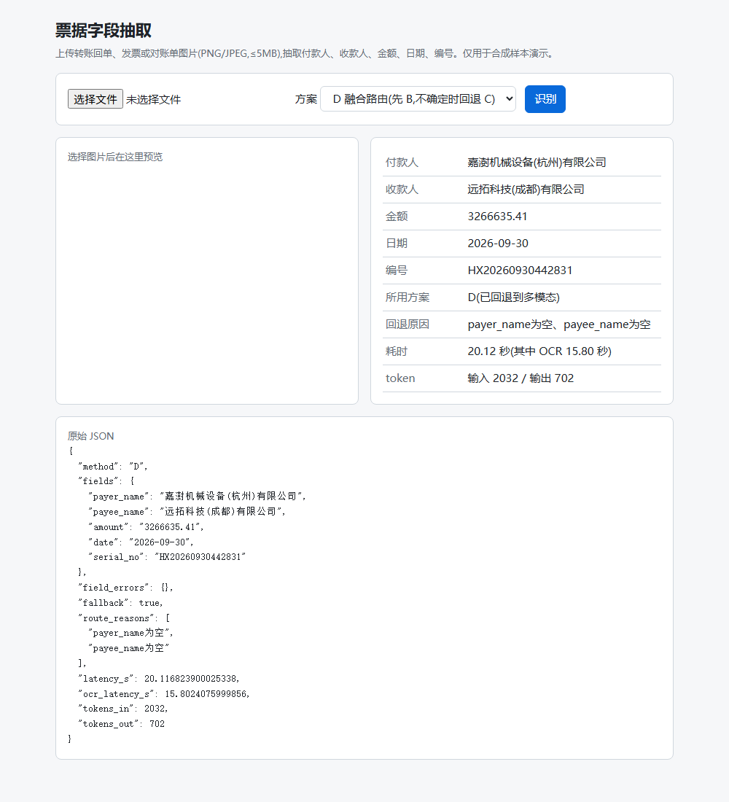

# 票据 OCR + 大模型融合信息抽取

从银行票据图片(转账回单、发票、对账单)中抽取 **付款人、收款人、金额、日期、编号** 5 个字段,输出结构化 JSON。对比四种方案,并做成 FastAPI 接口和网页。

> 全部样本为脚本合成,使用虚构的公司名和账号,不含任何真实个人或银行数据。



## 核心结论(72 张合成测试集)

| 方案 | 做法 | 整单全对 | 静默错误 | 单张耗时 P50 | 单张成本 |
|---|---|---|---|---|---|
| A | PaddleOCR + 关键词/坐标规则 | 69% | 6 | 19.3s | 0 |
| B | PaddleOCR 文本 → 大模型 | 83% | 6 | 21.1s | 0.0022 元 |
| C | 多模态大模型直接看图 | 85% | **10** | **1.5s** | 0.0023 元 |
| **D** | 先 B,字段为空时调 C 补 | **90%** | 7 | 21.3s | 0.0024 元 |
| **D-safe** | D + 低置信度回退 + B/C 冲突转人工 | **90%** | **5** | 21.3s | 0.0025 元 |

- **静默错误**:输出了值,但值是错的(下游发现不了)。银行场景里它比"留空"危险得多,所以单独统计
- B 擅长模糊件(75% vs C 58%),C 擅长遮挡件(83% vs B 33%);两者都错的字段只有 2 个,所以融合有效
- D 只有 8% 的单据回退到多模态,修好 5 张、改坏 0 张
- 耗时:CPU 上 OCR 约 19 秒是瓶颈,所以 C 反而最快;有 GPU 时结论会变
- 详见 [实验报告](docs/experiment-report.md)

## 快速开始(约 10 分钟)

需要:Windows / Linux / macOS,[uv](https://docs.astral.sh/uv/)。Python 3.11 由 uv 自动下载。

```bash
git clone <仓库地址> && cd OCR
uv sync                       # 安装依赖(含 PaddleOCR CPU 版,首次约 3~5 分钟)
```

**1. 不调用任何 API,复现实验报告的数字**(读仓库里已存的预测结果):

```bash
uv run python -m ocr_extract.eval.run_benchmark --reuse results/20261024_004217_benchmark_test --methods A,B,C,D,Ds
```

**2. 配置大模型**(方案 B/C/D 需要;只用方案 A 可跳过):

```bash
cp .env.example .env          # Windows PowerShell:Copy-Item .env.example .env
```

在 `.env` 里填 `LLM_BASE_URL`、`LLM_API_KEY`、模型名和单价。任何 OpenAI 兼容接口都可以(云端模型,或本地 vLLM/Ollama);多模态方案需要模型支持图片输入。本项目实测用的是 DeepSeek `deepseek-flash`(文本、图片都支持)。

**3. 启动服务和网页**:

```bash
uv run uvicorn ocr_extract.api.main:app --port 8000
# 浏览器打开 http://127.0.0.1:8000 ,上传 data/synthetic/images/ 下任意一张图
```

接口文档:`http://127.0.0.1:8000/docs`。命令行调用:

```bash
curl -F "file=@data/synthetic/images/receipt_occlusion_00.png;type=image/png" -F "method=D" http://127.0.0.1:8000/extract
```

**4. 其他常用命令**:

```bash
uv run pytest -q                                                    # 测试(不联网、不调模型)
uv run python -m ocr_extract.synth.generate --seed 42               # 重新生成 72 张测试集
uv run python -m ocr_extract.eval.run_benchmark --methods A,B,C --set test --subset10   # 小样本实跑(约 0.05 元)
uv run python -m ocr_extract.eval.run_benchmark --methods A,B,C --set test              # 全量实跑(约 0.35 元)
```

> 首次运行 OCR 会下载 PaddleOCR 模型。CPU 上单张约 20 秒;仓库里已带 OCR 缓存(`results/ocr_cache/`),跑现有样本不会重新识别。
> 如果开着代理,PowerShell 里注意 `$env:HTTPS_PROXY` 的设置;本地访问 127.0.0.1 时 curl 可加 `--noproxy '*'`。

## 目录结构

```
├── src/ocr_extract/
│   ├── schema.py              # 5 个字段的定义、归一化、校验(pydantic)
│   ├── synth/                 # 合成样本生成器:3 种模板 × 6 档难度
│   ├── ocr/paddle_engine.py   # PaddleOCR 封装:倾斜摆正、缓存、线程锁
│   ├── llm/client.py          # OpenAI 兼容接口,记录耗时和 token
│   ├── extractors/            # rule_based(A) / ocr_llm(B) / vlm_direct(C) / hybrid(D)
│   ├── eval/                  # metrics.py 指标 / run_benchmark.py 统一评估
│   └── api/                   # FastAPI + static/index.html
├── prompts/                   # extract_v1(B)、vlm_v1(C),带版本号
├── data/                      # synthetic(测试 72)/ synthetic_dev(开发 18)/ synthetic_tune(调参 36)
├── results/                   # 每次实验的原始结果,带时间戳和配置快照
├── scripts/                   # 单方案运行、D 的调参回放
├── docs/                      # 实验报告、架构、决策记录、面试问答、学习日志、流程文档
└── tests/                     # pytest
```

## 四种方案

| 方案 | 怎么做 | 优点 | 缺点 |
|---|---|---|---|
| A 规则 | OCR 后按关键词 + "右边最近的框"配对,正则清洗 | 免费、可解释、清晰件 100% | 换版式要重写;模糊 25%、遮挡 8% |
| B OCR+LLM | OCR 文本填进提示词,LLM 输出 JSON,pydantic 校验,不合格重试一次 | 读懂漏字、修正被认坏的千分位;出错多为留空 | 救不了 OCR 认错的字;看不到被遮挡的行 |
| C 多模态 | 原图 base64 交给多模态模型,同一套校验 | 遮挡件最强;不经过 OCR | 静默错误最多(形近字、编号漏位);没有"不确定"信号 |
| D 融合 | 先 B;校验失败或关键字段为空时调 C,只补 B 的空 | 90%,只多花 8% 的调用 | 救不了 B "很自信地错" |

## 局限与后续改进

| 局限 | 改进方向 |
|---|---|
| 合成数据只有 3 种版式、字体干净 | 内网用脱敏真实样本重新评估 |
| 调参集太容易,D 的阈值没有被数据确定 | 做更难的调参集(多种退化叠加) |
| B 在没有大写金额的对账单上越界修正金额(`294` → 2.94) | 提示词限制"只有存在大写时才允许修正";用明细余额做勾稽校验 |
| C 的编号常漏位 | 编号格式校验(在测试集分析时发现,未用于报告) |
| 文本和视觉用同一个模型 | 换专门的视觉模型对比 |
| OCR 只在 CPU 上跑 | GPU 或 OCR 服务化 |

## 数据安全

- API Key 只放 `.env`(已在 `.gitignore`),仓库只有 `.env.example`
- 真实银行场景要求数据不出内网:把 `LLM_BASE_URL` 换成内网部署的开源模型即可,代码不用改

## 文档

[实验报告](docs/experiment-report.md) · [架构](docs/architecture.md) · [技术决策](docs/decisions.md) · [面试问答](docs/interview-qa.md) · [学习日志](docs/learning-log.md) · [开发流程](docs/process.md)
