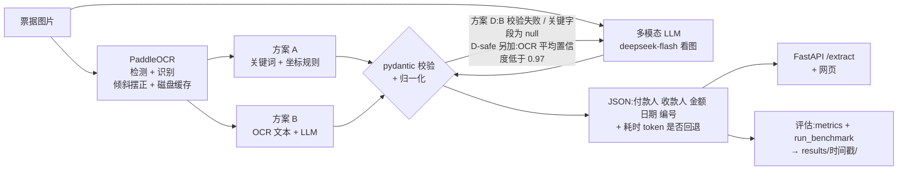

# 架构

## 一张图看懂

## 数据流(以方案 D 为例)

| 步骤 | 做什么 | 代码 |
|---|---|---|
| 1 | 上传图片,校验类型(PNG/JPEG)、大小(≤5MB)、能否真的解码 | `api/main.py` |
| 2 | PaddleOCR 识别文字行(文字、置信度、四角坐标),按倾斜角摆正后排成阅读顺序;结果按图片 sha256 缓存 | `ocr/paddle_engine.py` |
| 3 | 方案 B:OCR 文本填进提示词 → LLM(JSON 模式, temperature=0) | `extractors/ocr_llm.py`、`prompts/extract_v1/` |
| 4 | pydantic `ReceiptFields` 校验 + 归一化;不合格把错误发回重试 1 次;仍不合格只丢坏字段 | `schema.py`、`chat_with_retry` |
| 5 | 路由:B 校验失败 / 关键字段为 null → 回退(D-safe 另加:OCR 平均置信度 <0.97)。大写校验、编号格式校验已实现,但调参集上没有区分度,默认关闭(D25) | `extractors/hybrid.py` |
| 6 | 方案 C:原图 base64 交给多模态模型,同一套校验与重试 | `extractors/vlm_direct.py`、`prompts/vlm_v1/` |
| 7 | 合并:D 只用 C 补 B 为 null 的字段;D-safe 另外把 B、C 不一致的字段置 null 转人工 | `hybrid.merge` |
| 8 | 返回字段 + 耗时 + token + 是否回退 + 回退原因 | `api/main.py` |

## 模块职责

| 模块 | 职责 | 关键点 |
|---|---|---|
| `schema.py` | 5 个字段的定义、归一化、校验 | 金额 Decimal + 严格千分位;NFKC;`extra="forbid"`;解析不了就报错 |
| `synth/` | 合成样本:3 种模板 × 6 档难度,标签独立构造 | 每张图独立种子;字体缺字检查 |
| `ocr/paddle_engine.py` | PaddleOCR 封装 | 关 oneDNN;UVDoc 开;倾斜角取中位数;sha256 缓存;线程锁 |
| `extractors/base.py` | 统一输出 `ExtractionResult` | 字段、校验错误、耗时、token、原始输出、重试、是否回退 |
| `extractors/rule_based.py` | 方案 A | 关键词 + "右边/下方最近"的坐标配对;宁可 null |
| `extractors/ocr_llm.py` | 方案 B + B/C 共用的校验重试 | 提示词带 sha256 指纹 |
| `extractors/vlm_direct.py` | 方案 C | 原图 PNG,最长边 ≤1600 |
| `extractors/hybrid.py` | 方案 D | 路由/合并是纯函数,可用已存预测回放调参 |
| `llm/client.py` | OpenAI 兼容接口 | 换 base_url 即可接本地 vLLM/Ollama;记录思考 token |
| `config.py` | 读 `.env` | Key 不打印、不写入结果 |
| `eval/metrics.py` | 指标 | 字段/整单准确率、静默错误率、留空率、幻觉率、格式失败率、P50/P95、成本 |
| `eval/run_benchmark.py` | 统一评估 | `--reuse` 读已有预测,不花钱重算 |
| `api/` | FastAPI + 原生网页 | 启动时加载 OCR;同步接口进线程池 |

## 部署到银行内网时要换什么

| 现在 | 内网 |
|---|---|
| DeepSeek 云端 API | vLLM/Ollama 部署开源模型(文本 + 视觉),只改 `.env` 的 `LLM_BASE_URL`、模型名 |
| CPU 上的 PaddleOCR(单张约 19 秒) | GPU 版 Paddle,或 PaddleOCR 服务化部署 |
| 上传图片放临时目录 | 按数据规范落盘、加密、定期清理;接口加鉴权 |
